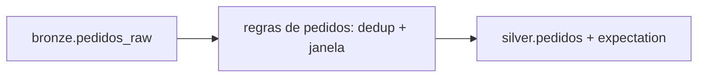

# DESIGN: Pedidos diários na camada silver

> Um pipeline Lakeflow serverless, declarado no bundle e agendado às 05h, lê a bronze e publica a silver com as regras de pedidos numa função Python testada em memória.

## Identificação

| Campo | Valor |
|-------|-------|
| **Feature** | PEDIDOS_DIARIOS |
| **DEFINE** | `docs/specs/DEFINE_PEDIDOS_DIARIOS.md` — v1.0 |
| **TASKS** | `docs/planning/TASKS_PEDIDOS_DIARIOS.md` — v1.0 |
| **ADR** | não há |
| **Data** | 2026-11-02 |

---

## Visão geral

## Abordagens

| ID | Abordagem | Prós | Contras |
|----|-----------|------|---------|
| A1 | Pipeline Lakeflow com materialized view; dedup e janela numa função Python | Regra testável em memória; expectation com métrica no event log | A view recalcula o dia a cada carga |
| A2 | Pipeline Lakeflow com AUTO CDC (SCD tipo 1) por `pedido_id` | Incremental, sem recalcular o dia | A regra de dedup fica no AUTO CDC e só tem prova de integração no `dev` |

**Recomendada**: A1 — a carga é diária e cabe na view, e as regras de R1 ficam onde o teste em memória alcança.

**Confirmada**: A1 — usuário: "vai de view, com a regra testável"

## Componentes

| Componente | Tipo | Onde fica | Critérios | Tasks | Constrói com |
|------------|------|-----------|-----------|-------|--------------|
| Pipeline `pedidos` | recurso do bundle | `resources/pedidos.pipeline.yml` | R2.3 | T1, T6 | @databricks-dabs |
| Regras de pedidos | módulo Python | `src/pedidos/regras.py` | R1.1, R1.2, R1.3, R2.2 | T2, T3, T5 | @databricks-pipelines |
| `silver.pedidos` com expectation de `valor_total` | materialized view + expectation | `src/pipelines/pedidos/pipeline.py` | R2.1 | T4 | @databricks-pipelines |

## Onde a regra roda

| Critérios | Onde roda | Prova |
|-----------|-----------|-------|
| R1.1, R1.2, R1.3 | `src/pedidos/regras.py::ultimo_por_pedido` | unitário em memória |
| R2.2 | `src/pedidos/regras.py::dentro_da_janela` | unitário em memória |
| R2.1 | expectation em `src/pipelines/pedidos/pipeline.py` | integração no `dev` (update + event log) |
| R2.3 | agendamento em `resources/pedidos.pipeline.yml` | integração no `dev` (event log) |

## O que já existe e será reaproveitado

| O quê | Onde | Como entra nesta feature |
|-------|------|--------------------------|
| Bundle do projeto, com target `dev` em `mode: development` | `databricks.yml` | O pipeline novo entra no mesmo bundle |

## Decisões

| ID | Decisão | Alternativa descartada | Por quê | Base |
|----|---------|------------------------|---------|------|
| D-1 | Dedup por `pedido_id` com janela em `atualizado_em`, numa função Python chamada pela materialized view | AUTO CDC SCD tipo 1 | A regra fica onde o teste em memória alcança; a carga diária cabe na view | @databricks-pipelines |

## Dados

| Tabela | Chave | Escrita | Observação |
|--------|-------|---------|------------|
| `silver.pedidos` | `pedido_id` | materialized view | O agendamento vai só no target de produção; no `dev`, o recurso não fixa `pause_status` |

## Riscos e pontos de atenção

| Ponto | Onde | Impacto | Mitigação |
|-------|------|---------|-----------|
| Dois eventos com o mesmo `atualizado_em` | `bronze.pedidos_raw` | Desempate instável entre reprocessamentos | R1.3 testa reprocessar a mesma partição; empate vira pergunta ao usuário se aparecer |

## Dado ruim e falhas

| Cenário | Tratamento | O que o consumidor vê |
|---------|------------|-----------------------|
| `valor_total` nulo ou negativo | Expectation descarta e conta (R2.1) | A linha não aparece; a contagem fica no event log |
| Bronze sem eventos novos às 05h | O update roda e não muda a silver | A silver do dia anterior |

## Testes

Testes unitários em `tests/unit/`, com DataFrames em memória e `assertDataFrameEqual` (PySpark 4.0). As provas de expectation e de horário rodam no target `dev`, lendo o event log do pipeline.

## Histórico de revisões

| Versão | Data | Mudança |
|--------|------|---------|
| 1.0 | 2026-11-02 | Versão inicial |
